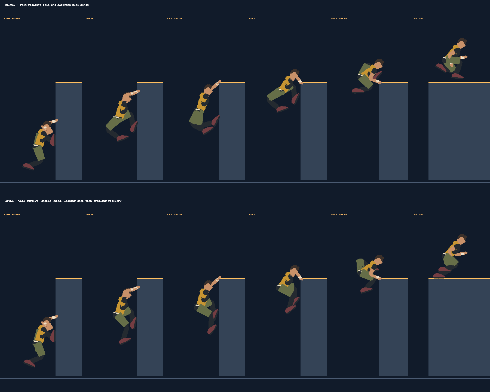

# Climb-up leg study

The high-wall climb now uses separate, ledge-relative foot trajectories: initial wall plant, a higher replant and push, leading-foot clearance and roof contact, then trailing-leg recovery. The leading support foot stays fixed in world space during the catch/early pull and again after landing on the roof. Shoe pitch changes from wall contact to flat roof contact. The last part blends back into the running stride.

## Reference comparison

- [London Parkour: foot position](https://londonparkour.com/tutorials/how-to-climbup-foot-position/) describes a high, secure foot acting as a pivot. Previously both feet rose with the body after the initial plant. The new track holds the high foot while the pelvis rises, giving the leg a visible extension phase.
- [London Parkour: wall-run climb-up](https://londonparkour.com/tutorials/wall-run-climbup/) connects the wall-foot push to the hand catch and upward press. The new leg timing distinguishes that push from the later roof step, with the trailing leg following instead of both legs folding together.

The old knee hints pointed backward during the hang and changed direction during the press. The new hints follow a consistent bend side relative to the hip–ankle axis, including when the ankle rises for the top-out. This matters because the rendered joints are solved by two-bone IK; a plausible ankle target alone does not guarantee a plausible knee.

The comparison uses the existing `node scripts/runner-study.cjs --wall` six-phase triangle export, sampled before and after the change. It is an offline side-view inspection, not browser or device playback. Gameplay traversal timing and root motion are unchanged.

Validation: model tests, motion tests, and TypeScript checking. Additional motion coverage samples 6, 10 and 14 m/s entry speeds and checks stationary wall support, reachable ankle targets after IK, consistent knee bend, and roof clearance before either foot crosses the face. Existing two-hand lip support and initial wall-plant checks remain in place.
