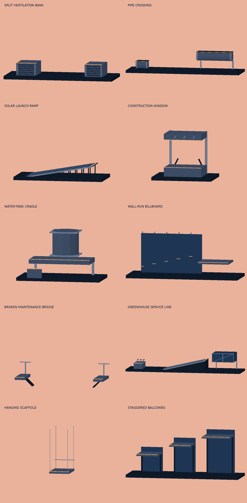

# Skystride — movement and course design

## Current course update — creative obstacles (v8)

Four authored encounter families now recur in the opening and three later rooftop blocks, for 24 interactive pieces:

- **Split ventilation banks:** the first pair begins at 217 m. Up in the approach window performs Kong then dash; an earlier jump can land on the first unit, followed by another jump over its partner. The exposed tops are physical support surfaces.
- **Solar launch ramps:** a 6 m panel incline rises 1.1 m into the gap at 240 m. Running follows the actual slope and costs uphill momentum. Jumping carries current speed from the raised launch point; the landing requires a timed roll. Feet and sole orientation follow the incline.
- **Billboard openings:** at 402 m, a 0.85 m sill sits below a header with a 3.45 m underside. A contextual vault passes through; mistimed high jumps hit the header. Header collision remains active after its scoring event, and the sign top is also a physical landing surface.
- **Pipe crossings:** at 424 m, dash the low pipe then slide beneath the raised pipe, or use an early jump to land on the first and jump onto the second. Flat service grating provides the top contact surface.

The later blocks repeat these encounters at offsets of 1,480, 1,960 and 2,440 m. Filler is excluded from their decision approaches and between paired contacts. Early Up remains a normal jump; contextual Up selects a vault when close. Right can opt for a free momentum-based jump near these props.

Clean simulation drivers finish in 238.59 seconds on normal (354 inputs) and 238.55 seconds on hard (350 inputs), with no forced recoveries. These are repeatable test-driver results, not optimal leaderboard times. Earlier v6/v7 metrics below describe previous course versions.

Geometry uses shared boxes/cylinders and the existing material batching, spatial culling and disposal. Solar panel cells are geometry, not downloaded textures. No new runtime dependencies, postprocessing or input delay were introduced. Physics and meshes use the same obstacle dimensions; raycast tests verify their contact planes.

This preview is an offline geometry study. Browser lighting, mobile readability and real-device play feel remain unverified. The v8 record key separates changed course physics from earlier local bests without deleting them.

## Visual reference

The supplied Skystride / Urban Silhouette concept is the visual direction: peach sunset, a pale warm sun, layered mauve skyline, navy roof silhouettes, thin amber roof edges, cream shirt and warm shoe accents. The scene uses original procedural geometry, including towers, vents, bridge silhouettes and pipework. This pass keeps that palette and composition; it is not a pixel-exact reproduction.

## Movement and timing

The character now has horizontal velocity, acceleration, vertical velocity, gravity and grounded state. Up jumps anywhere on a roof, with no obstacle required. Jump input is consumed on the next 120 Hz simulation tick. A 120 ms buffer accepts presses just before landing or traversal exit; 90 ms of coyote time permits a slightly late edge jump. There is no double jump. Holding a key does not auto-repeat actions.

Runs start at 7.5 units/s and build toward a cruising speed of 12 units/s. Clean actions build flow and retain extra momentum; running targets up to 13.5 and action boosts cap at 14. Stumbles and heavy landings remove speed. Ground acceleration is 3 units/s²; airborne motion retains takeoff momentum with only 0.12 units/s² drag, rather than accelerating toward cruising speed. Gravity is 30 units/s² while rising and 35.4 while falling and the standard launch speed is 12.4 units/s. These are arcade tuning values, not measurements of human performance or device latency.

Movement remains on a 2D plane. Roof tops, gaps, upper-route undersides and roof facades use shared authored geometry and fixed-step swept crossing checks. An impossible jump falls physically before failure; it cannot pass through the next roof facade. Lower-route jumps hit the underside of upper platforms. Obstacles use body-height checks and recoverable contact responses.

## Contextual parkour

Up inside a speed-scaled approach window selects the barrier’s authored vault. The clean opportunity is 300–400 ms on the normal line and 200–250 ms on upper hard routes. These are timing windows, not required intervals between inputs, as clarified by the user. Inputs within 0.55 units choose a slower safety recovery. An earlier up input is a normal ballistic jump. The special movement does not absorb arbitrary early inputs into a perfect vault.

Seven vault profiles remain. The course emphasizes Kong, dash, speed and lazy; step-over and step-on leap have been removed:

- Hurdle: no hand support, split legs and forward lean.
- Speed vault: low torso, trailing legs and a support hand.
- One-hand vault: asymmetric leg tuck and free-arm counterbalance.
- Safety vault: more upright, supported step-through and a time penalty when late.
- Lazy vault: reclined torso, legs leading over the obstacle.
- Kong: forward dive, two-hand support and compact knee tuck.
- Dash: both feet lead, then both palms brace behind the hips and push into the exit.

Vault paths rise before the obstacle, retain clearance across its full width and descend after the trailing edge. Their poses have entry, contact, tuck and release phases. Hands aim at world-space obstacle anchors while within anatomical reach. Two-bone inverse kinematics keeps arms and legs consistent in length. Contact releases as the shoulder passes beyond reach.

Up at a branch performs a wall step onto the high line. Four entrances now have 3.3-unit walls with a foot drive, two-hand catch, pull, palm press and top-out sequence. Their faces occupy the rear route lane so the normal line can pass in front. A fresh up input near a reachable lip while falling catches it, hangs briefly, then climbs. Up during the hang commits the climb sooner; down releases. Unreachable ledges do not rescue the player.

Down on the roof starts a 0.62 second slide, extending the low stance until the overhead obstacle is clear. Down in the air arms a landing roll for 250 ms on upper routes or 400 ms on the normal line. Drops over two units or impact speeds over 14 require a roll to preserve momentum; otherwise a compressed heavy landing costs speed. The roll rotates the tucked body through a full cycle. Jumping can interrupt ground recovery, while non-interruptible vault contacts accept buffered exit input.

Right / D / swipe right performs a long jump when current speed is at least 11.5 units/s, using a 13.6 units/s vertical launch. At lower speed it performs a normal jump and shows a build-speed cue. It never adds horizontal speed on takeoff. Up/down remain the essential controls. Swipe recognition uses an adjustable 10–32 pixel threshold (18 default), before release, with one action per contact.

## Sunset Relay v8

The course is now 3,000 units long with boundaries at 1,000, 2,000 and 3,000. The extended spacing supports the faster pace. Two upper routes add wall steps, gaps, vaults and drops; the lower line uses barriers and ducts. Both clean routes are exercised end-to-end by simulation tests. Tests verify that the clean upper route beats the clean lower route. Repeated mistimed vault jumps can now lose enough momentum to fail a later gap; air acceleration does not rescue those attempts.

Practice starts from a sector boundary and continues to the end; it does not yet loop isolated sectors or select upper-route entry states. There is one course. Pursuit, collectibles, online rankings, controller support and sound are not implemented in this pass.

## Presentation and competition

The camera renders interpolated player positions between simulation ticks, looks ahead and eases vertically with elevated routes. A branch approach adds a small upward anticipation. No shake or dramatic zoom. Touch keeps the full play area as its gesture surface. Native fullscreen and landscape locking are requested where supported; edge-to-edge browser play remains available. Rotation, focus loss and long frame stalls pause the run and remove personal-best eligibility.

The HUD shows time, personal best, route, current speed and flow. Results include sector times and difference against the previous best. The new course key is skystride.sunset-relay-v8.best, keeping incompatible earlier records separate.

Records now contain tick-stamped inputs and sampled animation frames. Tests reconstruct a complete upper-route run from its recorded inputs and compare its entire resulting record. This is local reproducibility testing; no server validation or cross-device determinism certification is claimed. Local saved data is not trusted competition data.

## Movement study

Open /movement-lab to inspect the actual runner and simulated movements. Choose a move, slow it down, freeze it or scrub the pose slider. This is an animation review tool, separate from the minimal gameplay HUD. It uses the same procedural runner and controller as the course. The live articulated runner uses shared model geometry in src/assets/runner-model.ts. A GLB of that exact geometry is exported at public/models/skystride-runner.glb; no purchased character, mocap clips or AnimationMixer is used.

## Animation strength pass

Vector is the requested reference for readable, athletic parkour silhouettes ([official game reference](https://vector.game/)). Skystride keeps its own cream shirt, navy silhouette and amber soles. The rig now uses tapered limbs, a shoulder-to-waist torso, a shaped head and swept hair, and angled sneakers. Far limbs use a muted navy to keep overlapping limbs readable.

The sprint follows distance traveled. Each support foot remains fixed in world space during stance, then moves through toe-off, heel recovery, knee drive and forward reach. Opposing arms and a forward torso lean support the stride. Jump animation extends through a 65 ms push-off, drives the lead knee and opposite arm, opens into flight, and reaches down according to descending velocity. Visual anticipation adds no input delay. The existing 120 Hz controller, jump buffer and coyote time remain active.

Landing compression is driven by recorded impact velocity. Heavy landings bend the hips and torso more deeply and recover longer; lighter vault exits move back into the sprint sooner. Small, short-lived dust bursts remain at the actual takeoff and landing positions. There is no added hit-stop. The kong tuck brings the knees under the chest; supported vaults release their hand anchors when they leave arm reach. Each vault has its own support, clearance and exit poses.

Animation sampling is a pure function of the movement frame. Broad stateful smoothing has been removed; authored phase timing provides transitions. Live rendering, the study and recorded ghosts interpolate motion clocks with position. Optional launch, lead-leg and impact metadata preserve compatibility with existing v2 records. The study adds a five-pose sheet, phase names, a heavy-landing example and accurate freeze/scrub controls; real speed is the default.

## Verification

Run npm test, npm run tsc, npm run lint and npm run build-pre. The regression suite covers free jumping, no double jump, buffer expiry and landing buffers, coyote grace, full clean routes, momentum differences, all vault selections, complete obstacle clearance, vault-exit buffering, slides, roll timing, ledge catches, ceiling/facade collision, pause/restart, replay validation, exact input playback and gestures.

Animation regressions also check planted world-space feet, anatomical IK lengths at unreachable/singular targets, knee drive and landing reach, impact-dependent compression, frame-rate-independent pose sampling, transition interpolation and finite geometry through every vault.

Windows x64 explicitly includes the matching optional Mako native dependency because the inherited lockfile omitted it. This remains optional on other operating systems.

Browser review checks gameplay and the movement study. Real-phone latency, thermal behavior, native fullscreen/orientation support and sustained mobile frame pacing still require device playtesting. The runner is an improved procedural animation system, not finished character production art.

## Urban Silhouette asset and marathon course

The runner uses a shaped cream shirt with a dark side inset, layered swept hair, loose upper trouser legs, amber soles and a short amber sash. These original meshes are assembled by the existing IK rig. `node scripts/export-runner.cjs` regenerates the approximately 400 KB GLB from the same geometry and rig; it is an articulated mesh asset in a sample sprint pose, not a skinned skeleton with baked animation clips. Runtime continues to animate the shared geometry directly, so gameplay and exported asset stay aligned.

Chest and head lean increase continuously between 6 and 14 m/s. Airborne leg reach and opposing arm drive increase with speed; the planted foot path remains unchanged to prevent skating. Vertical speed falls toward zero at the crest and increases on descent under gravity. Horizontal speed is carried from takeoff, so slower approaches make shorter jumps. Vaults ease over support and accelerate toward release, with a longer safety-vault duration. No input delay, hit-stop, or global slow-motion effect is introduced.

The 500–1450 m district supplies 48 obstacles on each line, emphasizing the four primary vault families, with regular slide passages and gaps on the upper line. Its 950 m length lasts at least 67.8 seconds at the 14 m/s flow cap. It follows the opening course and leads into three rooftop blocks and a final approach. Both complete routes are tested to finish in 180–300 seconds with zero forced recoveries. Repeatable patterns support route learning. Ledge catches remain a recovery opportunity rather than a mandatory failure.

Roof trim, railings, water tanks and checkpoint posts have neutral edges. Amber strips mark interactive vault surfaces, ducts, branch lips, gap edges and drops. Background sunlight and the runner’s costume accents retain the concept palette. Static boxes are instanced by material within 80 m chunks so distant districts can be culled; skyline layers wrap beyond the old 480 m extent.

The course/replay key is now v8 because layout, timing and traversal trajectories changed. Existing records are left in storage but are not compared against the new course. This pass was checked through simulation, type checking, lint, production compilation and a software-rendered character pose study. Browser gameplay and real-phone feel still need visual/device playtesting.

## Character surface refinement

The arms and trousers now use continuous deforming mesh surfaces through the existing two-bone IK joints. Rounded bends replace separate cylinder ends and visible knee/elbow balls. Each of four limb surfaces uses 25 cross-sections and 12 radial segments; vertex buffers are reused and normals updated after deformation. Joint targets, contacts and gameplay trajectories are unchanged.

The shirt uses a curved volume with tapered waist and rounded shoulders. Face, hair, shoes and sash use curved outlines and small multi-segment bevels. A collar, shoe upper panels and thumb volumes add detail. Rough, softly lit materials make the surfaces readable in the actual Three.js lighting while preserving the navy/cream/amber palette. This is still a procedural articulated model, with continuous limb deformation rather than a full skinned character asset.

The GLB export includes the refined geometry. A software pose study checked cruise, sprint and Kong silhouettes; the runtime lighting and mobile GPU cost still need browser/device review. Animation regression tests cover bend stability and outward-facing limb normals in addition to previous IK/pose checks.

## Dense obstacle chains

The course now has 567 obstacles across the two routes, up from 189. Added approach obstacles alternate compact vaults and narrow ducts. New contacts are spaced 5.8 m along the hard line and 7 m along the normal line where the existing terrain permits. Gap landing areas, wall-step exits and route rejoin zones retain clearance; obstacles are not inserted into those recovery paths.

Clean simulation attempts require 362 inputs on the normal route (previously 107) and 358 on the hard route (previously 125). With the contact and momentum pass, the clean normal attempt finishes in 4:00.68 and the hard attempt in 4:00.24, both without recoveries. Full-route tests enforce at least 350 actions and a median interval below 650 ms. This increases input frequency while retaining the previous clean timing windows and movement speed. The v7 record key separates these results from earlier physics and less-dense courses.

## Contact and momentum pass

Running hips now compress during the planted part of each stride and rebound after toe-off, with chest/head following that motion. Faster running increases the compression and existing forward lean. Descending jumps extend both feet ahead of the hips. Landing plants both feet before recovering into the run or rolling; heavy impacts add a hand brace and a longer, 380 ms recovery. A missed roll removes 4.2 units/s and briefly lowers the recovery-speed target. The existing 250/400 ms roll windows are unchanged.

Slide entry has a 70 ms crouch, followed by leg extension into the low pose by 170 ms. Input and low collision state still take effect on the next simulation tick. Sliding removes up to 0.7 units/s at entry and continues losing up to 1.9 units/s² toward 10.8 units/s. It never speeds up an already slow runner. Standing blends back over 160 ms, while normal running rebuilds momentum at up to 3 units/s². This makes slide-heavy paths slower than clean vault paths without adding input delay.

Kong now has distinct leg-load, leg-push, hand-plant, hand-push and release phases. The initial load stays near the roof before the dive. A second lift begins after hand contact, with a one-time 0.3 units/s exit impulse; the whole traversal retains obstacle clearance. These are authored arcade trajectories rather than a rigid-body character simulation.

Narrow ducts have a 1.65-unit top and a 1.25-unit underside. Up can slowly climb over them when there is overhead clearance; Down slides underneath faster. Ducts beneath another roof do not offer a climb. The HUD exposes the choice only where it is valid, and the movement study includes a mantle preview. Rendered beam height and collision height use the same obstacle data.

The latest full-course simulation finishes both routes with zero recoveries and 362 normal / 358 hard inputs. The technical district takes approximately 77 seconds on the normal route and 75 seconds on the hard route. Regression tests cover momentum loss/recovery, no slide speed boost after a stumble, climb clearance and duration, the second Kong lift, body rebound, two-foot/hand landing targets, slide entry and reachable hand support. Offline rendering of the actual articulated geometry checks the transition silhouettes. This pass has not been visually verified in a browser or on a phone.

## Silhouette, momentum and high walls — v6

The current runner replaces the earlier cream-shirt/sash costume with a dark athletic silhouette inspired by Vector and Shadow Fight. The torso has independently shaped rib-cage depth, shoulder width and waist sections. A rounded pelvis, tapered thighs/calves and continuous arm surfaces meet the existing IK targets. The head/neck proportions, short hair profile, hands, shoes and arm swing have been revised. Running arms now swing along upper-arm/forearm arcs rather than collapsing toward the ribs during the middle of a stride. This remains original procedural articulated geometry, not imported character animation or a mocap asset.

The reference research used [Nekki’s Vector page](https://vector.game/), [Cascadeur’s account of its Nekki origins and physics-based approach](https://cascadeur.com/about), and [London Parkour’s wall-run/climb-up lesson and transcript](https://londonparkour.com/tutorials/wall-run-climbup/). The wall lesson informed the sequence from foot drive to ledge catch and upward press. Those observations guide authored game poses; the runtime does not use Cascadeur or simulate a complete biomechanical body.

Flat-ground simulation measurements illustrate the momentum rule:

| Takeoff speed | Normal jump | Right / forward input |
| --- | --- | --- |
| 6 m/s | 4.71 m | 4.71 m; normal jump |
| 9 m/s | 7.09 m | 7.09 m; normal jump |
| 12 m/s | 9.46 m | 10.35 m; long jump |
| 14 m/s | 11.05 m | 12.09 m; long jump |

These use the game’s units and fixed-step flight on a level roof; actual gaps depend on takeoff location and landing height. Regaining 11.5 m/s from 6 m/s takes about 1.84 seconds of uninterrupted ground acceleration. Jumping while slow does not bypass that recovery. Long jumps still require an appropriately timed roll for a hard landing. The HUD shows when long-jump speed is ready.

Four high-route entrances at 115, 1595, 2075 and 2555 m lead to 3.3 m wall faces. The character moves into the rear climbing lane, plants a foot, drives upward, holds the lip, pulls and presses, then lifts the leading shoe above the lip before stepping onto the upper roof. Slower approaches lengthen the climb; exiting removes 10% of carried speed. Eight upper technical-district ducts become wide Kong obstacles, reducing slide friction for clean high-route play and preserving a time advantage despite climbing. Total obstacle count remains 567.

The movement lab adds long-jump and wall-climb previews plus a 6–14 m/s entry-speed slider. The shared GLB is regenerated from the same runtime geometry. `node scripts/runner-study.cjs --wall` produces an offline triangle study for the six wall-climb phases. No new runtime dependencies or postprocessing were added; the 120 Hz input/simulation loop is unchanged.

The regression suite covers takeoff-speed distance, long-jump readiness, slower momentum recovery, all four wall exits, planted-foot/hand contacts, leading-shoe clearance, deterministic replay and the existing full-course checks. The v6 key separates the new physics and course from previous personal bests without deleting them. Character pose inspection uses offline geometry renders; browser lighting, animation feel and real-phone performance still need device review.

## Running swing, contact chaining and readability — v7

The running forearm now rotates relative to its upper arm instead of always pointing forward. Opposing shoulders drive one wrist behind the hip while the other reaches forward. Swing increases with speed; planted feet, body compression, shorter neck, longer shins and amber soles remain intact.

Branch inputs now work from the original approach window to 0.2 units before the visible wall face. Late attempts still lose momentum, but do not reject the climb. Airborne inputs only engage within 0.8 units of the wall and below its lip. High airborne catches preserve the current position and lift before moving across the ledge. Grounded late climbs never move backwards to a preset approach point.

Vaults and ducts now have physical top support surfaces independent of whether their scoring event has been handled. Descending onto one allows an immediate up/right jump. A supported low-duct mantle can also be interrupted once the runner reaches its top; wall climbs accept follow-up input once the feet reach the roof. Traversals without foot support remain non-interruptible and retain the short input buffer.

Down from a supported obstacle top initiates a feet-first edge slide. It carries the runner to the actual edge, falls under gravity, blends into a two-foot landing reach, and arms a landing roll. It does not teleport to the floor or add an airborne jump. Tall lower-route duct tops retain their lower-route identity.

Of 332 vault obstacles, 320 now use the four requested families: 86 speed, 76 Kong, 81 dash and 77 lazy. The 567-obstacle course still completes in approximately four minutes: normal 240.68 seconds / 362 actions; hard 240.24 seconds / 358 actions, with zero forced recoveries in the deterministic clean-route driver. Version v7 keeps previous local bests separate because movement and obstacle assignments changed.

Background service props and water towers use lighter, desaturated unlit materials and sit farther behind the running lane. Interactive barriers retain darker dimensional faces; amber tops and duct undersides identify usable surfaces. Decorative objects have no amber interaction strips. No postprocessing, extra lighting passes or assets were added. Support arrays are built once rather than allocated in the 120 Hz loop.

Verification includes late/airborne climbing, physical obstacle-top landing on both routes, immediate follow-up jumps, mantle interruption, gravity-driven exits, opposing arm swing, real dash hand contacts, full-course balance and deterministic replay. Offline geometry pose studies inspect sprint and dash poses; they do not verify browser lighting or real-device feel.

## Creative encounter course — v9

All ten families are authored into the opening district and its later repetitions. The route is still a deterministic 3,000 m time trial. Amber marks usable contacts; greenhouse glazing and background structure have no amber trim. A changed replay version separates these times from older courses.

| Encounter | Animation and input sequence | Route choice |
| --- | --- | --- |
| Split ventilation bank | Up: leg-load, Kong hand plant/push, release; next Up: feet-forward dash | Early jump uses the first unit as a launch surface |
| Solar frame | Feet align to the slope, upward momentum costs approach speed, jump from raised edge | Elevation helps the following gap; prepare a landing roll |
| Tank cradle | Down: crouch/slide; Up: one-hand lazy vault in front of the support; Right: hand-supported platform climb | Slide, side brace or elevated launch |
| Wall-run billboard | Up: knee-driven entry, alternating wall contacts, outward kick to the exit deck | Optional elevated line; Up again jumps from the deck |
| Pipe crossing | Dash over the low pipe, absorb landing, crouch into overhead slide | Launch from a supported top to bypass the low line |
| Broken bridge | Push-off, ballistic flight, feet-forward landing; late Up can catch the far lip | Clean jump or slower catch-and-climb recovery |
| Construction window | Right at speed: leg load, horizontal reach, leg tuck, landing roll; Up: sill vault | Fast committed dive or supported vault |
| Greenhouse | Planter vault, Up to service ledge, then jump before its edge | Clear the glazing; hitting glass ends the attempt |
| Suspended scaffold | Descending landing on the small deck, impact absorption, immediate next jump; Up can catch its lip | Intermediate upper landing; normal lower course remains available |
| Staggered balconies | Foot-driven high climb, hand catch, pull/press; repeated Up climbs the next ledge | Keep climbing or jump out toward the roof |

Platforms retain their route ownership independently of their height. Thin decks have underside/fascia collision, and glass is excluded from support surfaces. A scaffold is suspended visually but deliberately stationary, so attempts do not depend on a moving-platform phase. Wall-run and dive are inspectable in the movement lab. The geometry sheet in `creative-obstacles.png` is an offline render of the actual shared Three.js meshes, not a screenshot of live gameplay.

The fixed 120 Hz simulation, direct swipe handling and shared geometry/material resources remain in use. No physics package, postprocessing or new runtime dependency was added. New encounter regression tests cover three tank actions, billboard top-out, dive-to-roll, balcony chains, greenhouse collision, and both complete routes. Browser/mobile motion feel and final difficulty balance still require playtesting.

## Greenhouse accessibility fix — v10

The greenhouse no longer forces a service-ledge jump. Its glazing begins at 1.25 m, leaving a visible ground-level slide passage; the rear supports stay outside the running lane. The service ledge also respects the crouched collision height. Slide stays active while beneath the glass, including at low entry speed. The elevated jump remains available, with a dedicated edge-launch cue. Amber under the frame marks clearance, not a usable glass landing. Regression coverage exercises every repeated greenhouse at 5.5, 9, 12 and 14 m/s plus the low approach under its service ledge. Replay version advances because the available routes changed.

## Greenhouse sequence recovery — v11

Fixed a missing low-speed case: a slide now remains crouched beneath the service ledge until the runner clears its trailing edge. Previously its timer could expire inside the visible passage. The complete low line uses Down before the ledge and Down again before the greenhouse frame. Tests exercise that sequence across all repeated sections at 5.5–14 m/s, plus slower ledge crossings.

Glass still cannot support the runner, but a missed upper jump now makes recoverable frame contact instead of immediately ending the attempt. The runner loses momentum, falls outside the entry face, and can slide underneath after landing. Contact is charged once per frame. A regression covers this failed-jump-to-slide recovery. This supersedes the v9 instant-failure behavior.

## Course flow pass — v12

Replaced the greenhouse's abrupt service-table climb with a closed 6 m ramp from x=271 to x=277 in each repeated district. The main sequence is now planter vault → continuous run up the ramp → jump over the greenhouse → prepared landing roll. The ramp is visibly solid, so it no longer suggests sliding beneath a table. The greenhouse's low passage remains a recovery option after missed upper-line contact. Earlier service-table/two-slide instructions are superseded.

Course-wide review uses complete normal and hard runs with both 1.5 m and 2.2 m contextual approaches, in addition to the original 1.9 m driver. All finish without forced recoveries; separate jump/vault inputs retain at least 150 ms separation. Dedicated ramp checks cover every repeated greenhouse at 9, 12 and 13.5 m/s. These checks cover authored chains, generated filler contacts, technical sections, route joins and final gaps. They verify traversability/timing tolerance, not subjective controller feel.

The HUD prioritizes landing-roll guidance during descending elevated/long jumps, rather than immediately displaying a later vault. This makes momentum loss from an unprepared landing more avoidable throughout the course. The 120 Hz physics and real momentum requirements remain unchanged. Versioned best times advance to v12 because the course geometry changed.

## Authored combos and movement lab — v13

The technical district now contains 20 named three- to five-contact phrases on each route (96 authored contacts per route). These replace repetitive generated contacts in that district; the opening, later districts, greenhouse ramp and speed-dependent jumps remain. Names and per-chain contact numbers appear in the HUD. Deliberate spacing replaces the former 650 ms median-cadence target with an 800 ms limit, retaining at least 280 inputs over a complete route and a 3–5 minute run. No combo multiplier was added.

All 20 designs have playable first-pass course interpretations: Vent Relay, Over–Under, Planter Slalom, Roof Transfer, Window Express, Wall Redirect, Scaffold Traverse, Rail Precision, Crane Reach, Descending Flow, Corner Cut, High-Line Escape, Gate Thread, Stride Stones, Wall Traverse, Rail Switch, Drop Through, Monkey Relay, Beam Duck and Roof Rollout. Lower routes use compact supported crossings where overhead upper-roof clearance makes a gap jump unsuitable. Upper routes keep aerial crossings and replace selected ducts with Kong contacts. Landing corridors in Rail Precision and Beam Duck were lengthened after full-route checks found late contacts.

Sixteen procedural movement profiles cover tic-tac, underbar, double Kong, lache, rebound, precision, canopy slide, palm drop, monkey traverse, reverse vault, squeeze, running strides, shimmy, lateral transfer, drop-through and moving crouch. Their obstacle geometry is shared between the game and the lab; amber marks support/contact areas. These are authored contact trajectories on the existing articulated runner, not imported motion-capture clips or a general-purpose climbing physics system. The terrain motifs remain compact rooftop arrangements: multi-building crane branches, arbitrary lateral route switching are not implemented by this pass.

Up initiates a contextual move. Right during a bar contact releases into the existing gravity simulation with current horizontal speed and timing-dependent vertical velocity; Down drops to the lower exit. Unprompted bar contacts have a timed automatic exit, so a missed release does not trap the run. Release actions preserve position and do not reset momentum. Alternating planter vaults mirror the pose.

Movement lab: every new technique is selectable, plus `CHAIN · …` previews for all 20 combinations. These previews replay scripted inputs through the real simulation; they are not player-controlled practice runs. Existing speed slider, freeze, scrub, slow playback and five-pose sheet remain. Bar release can be early, normal, late or automatic. A pure lab sampler is shared with regression tests so an empty or unfinished selection fails verification.

Verification covers every authored signature on both routes, finite contact animation, all lab selections, full normal/hard routes at varied approach distances, deterministic replay, release continuity and controlled cat drops. Offline geometry studies can be exported with `node scripts/obstacle-study.cjs --signatures`. Browser/mobile animation feel and final visual contact polish remain to be playtested.

## Airborne bar crossings — v14

Underbar, lache and monkey-traverse contacts now span actual roof gaps on both routes. Up jumps from the approach; a catch requires an airborne runner within hand reach and a recent jump input. Walking off the bank cannot trigger an automatic traversal. The bar supports stand on the banks, and amber edge markers identify the crossing. Shimmy remains a supported wall contact.

Right releases with current horizontal momentum into gravity; timing changes the release position and arc. Lower-route release arcs respect the upper deck's clearance. Down drops into the void, so it is no longer a safe shortcut beneath these bars. The timed automatic release remains as a fallback but also uses airborne physics rather than snapping onto invisible ground. A missed grab can lose the run.

Movement-lab uses the same jump/catch simulation and visibly split roof banks, including full combo previews and release timing controls. Regression checks cover real support gaps, no walking grabs, airborne takeoff, far-bank landings, full-route completion and deterministic replay. Browser/mobile feel still needs hands-on playtesting.

## Longer, faster bar crossings — v15

Swing gaps expand from 3.8 m to 12.6 m, beyond an ordinary maximum-flow long jump including landing tolerance. The grab stays near the launch bank so takeoff remains reachable. The swing phase is shortened from 0.9 s to 0.55 s; release supplies a 30 m/s arcade carry impulse to cross the extended void, with normal grounded deceleration after landing. Lower-line release arcs are calculated for clearance beneath the upper roof. This impulse is deliberately stronger than running speed, rather than a physically passive pendulum.

Each affected combo gains 8 m after its swing to retain the next approach and landing corridor. Later chains shift with it. Shared gap dimensions drive course support, roof markers, support posts, movement-lab floors and offline geometry studies. Record version advances because crossing timings and course layout changed.

## Far-end bar grip — v16

The airborne grab now targets the final 20 cm of the reachable bar section instead of its midpoint. Single crossbars move to that contact position; monkey traverse uses its final rung. The swing keeps this anchor through release, shared by gameplay and movement-lab. Gap width and swing duration remain unchanged.

## Speed-responsive camera

Gameplay uses smoothly eased orthographic zoom: 1.28× at rest, 1× at 12 m/s and 0.76× at 30 m/s. Acceleration opens the view faster than deceleration closes it. Look-ahead scales with the visible width, keeping the runner at a stable horizontal screen position and preserving the forward corridor on portrait displays. Pause freezes zoom; resize preserves it. Reduced-motion preference uses a stable wide view. Movement-lab retains its close inspection framing.

Slow-speed framing now reaches 3.84× zoom (three times the previous 1.28× close view), easing back to 1× at running speed. Close framing also lowers the camera toward the runner's torso to keep the body visible. Fast-speed and reduced-motion framing remain unchanged.

## Missed-input penalties — v26

Late vaults now remove 30% of entry speed, reset flow and exit into a 350 ms stumble. Missing a vault completely stops the runner on the near side with a 1.2 second fall/get-up animation; the obstacle remains active for a deliberate retry. Missing a slide causes a backward knockdown with 1.35 seconds of recovery. Neither knockdown can be cancelled by jumping or sliding; the normal final 120 ms input buffer remains available.

Missing a required landing roll produces a hands-and-knees landing, removes 65% of entry momentum immediately and settles to a stop during 650 ms of recovery. Clean rolls preserve the existing behavior. Crash, backward knockdown and heavy landing have separate poses with impact, down and get-up phases. Airborne collisions continue falling under gravity before recovery begins on a real support surface.

Missed jumps and bar grabs still fall into the void and fail. Reachable roof lips require Up within 180 ms of contact; Forward no longer doubles as a ledge-save input. A successful catch consumes that Up opportunity and climbs as before. Record version advances to keep earlier time trials separate. Regression coverage checks locked recovery, obstacle retries, speed/flow loss, clean routes, falls, ledge saves and finite rendered recovery poses. Browser/mobile feel still needs hands-on playtesting.

## Selectable penalty mode — v27

Course selection now offers Standard (default) and Hardcore independently of time trial or practice sector. Standard restores the earlier assisted barrier crossing, slide stumble, lighter heavy landing and Up/Forward ledge-save behavior. Hardcore contains the v26 crash penalties, locked recovery, 30% late-vault speed loss, and Up-only ledge saves. Both retain fatal missed jumps/bar grabs. Retries retain the chosen mode; returning to the course menu allows switching. Best times and ghosts are stored separately by mode, and records include a validated mode field. Earlier record keys remain untouched.

## Connected building blocks

Long continuous roof surfaces are now rendered as adjoining buildings, usually 16–32 m wide. Facade colors, window proportions, floor bands, depth and party-wall piers vary between buildings. Rear wings have staggered rooflines from 1.4 m below to 5.2 m above the running terrace, with occasional rooftop service housings. Wings remain behind the obstacle corridor. The connected running terraces retain the existing shared collision heights and authored gaps; this is an architectural visual change, not a new course layout. Existing geometry/material reuse, culling and disposal remain in place.

## Physical connected rooftops — v28

This replaces the rear-wing-only interpretation above. Eight lower-route stretches now contain actual lower buildings, 0.7–1.4 m below their neighbors, joined by 3 m ramps. Four occur in the repeated districts and four in the long technical district. The shared surface definitions drive rendered rooftop slopes, foot support, landing collision and runner tilt. Obstacles use the new roof elevations; upper routes retain their independent height. Practice spawns use the physical roof height. Extra rear wings from the previous visual pass have been removed; contrasting adjoining facades remain. Replay version advances for the changed physical course.

Full-route checks cover both routes, varied input timing, Standard and Hardcore. Additional checks walk each new building and both ramp seams against the shared height function and verify practice spawning on the roof.

## Cinematic feedback and upper landmarks — v29

Large gaps now open camera framing over the final 28 m of approach and retain the wider framing through flight. The runner leans into upcoming gaps and landmark approaches without delaying inputs. Landings and crashes receive a brief, small camera impact response; reduced-motion keeps stable wide framing and disables the impact nudge. Strong impacts and sustained clean flow produce fuller landing dust. Clean contacts play rising synthesized tones, five-contact milestones play a three-note reward, and impacts play a low thud. Sound starts only after player interaction and can be disabled in the menu. Audio resources are disposed with the scene.

Consecutive clean movements use the existing earned momentum/flow system, with explicit perfect-chain milestones every five contacts and stronger sound/visual feedback. No sudden extra acceleration is injected into authored jump approaches. Any existing recovery resets flow.

Three upper-route phrases now have distinct landmarks: Crane Reach has a tower and trussed jib with a suspended bar and narrow scaffold exit. Manual release at 50–72% of the swing retains the fast upper exit and rewards a clean release; early, late or automatic release drops toward a slower lower scaffold recovery. The HUD indicates the release window. High-Line Escape now wall-runs a large billboard, crosses its supported frame and leaps a 10 m gap, with a roll required on the lower-height destination roof. Stride Stones becomes a glass-gallery crossing with three fixed 4 m gaps and narrow solid beams. Decorative glass sits off the running line and below the beam tops; there is no destructible-glass simulation. Lower-route contact chains remain available. Beneath the billboard, a duct and low passage make the ground route slower than the clean frame shortcut.

The record version advances for these encounter and reward changes. Full-route simulation covers both routes and both penalty modes, with appropriate roll input on the billboard landing. Targeted tests cover crane release outcomes, fixed skylight footing, chain reset and anticipatory camera behavior.

## Building-to-building wall runs — v30

The four district billboard wall runs and the upper billboard shortcut now cross real five-metre building gaps. Up on approach starts the takeoff/contact/crossing sequence and transfers the runner to the existing elevated far-bank deck; another Up can launch from that deck. Shared surface cuts remove the roof and facade beneath the crossing. Bank-mounted supports and amber takeoff/landing marks identify the wall connection. Missing the wall run leaves the runner falling into the gap, with lower-route recovery possible where a real lower surface exists. These crossings also trigger the pre-jump camera pullback. Replay version advances for the new physical voids.
