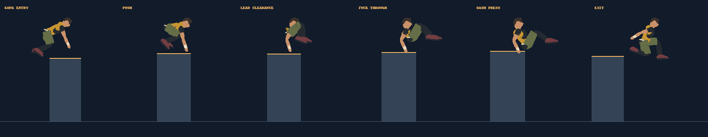

# Kash vault

Up now selects a Kash vault for the uncovered, non-tank slide obstacles up to 1.8 m high that previously triggered a mantle. Down still slides beneath them. Movement Lab lists `kash`.

The sequence blends a two-handed Kong entry into a tucked leg pass and a feet-first Dash press, then the shared landing pose. The second support advances 0.45 m across the top. Traversal preserves approach speed, keeps moving horizontally, and uses travel distance divided by entry speed for its duration, avoiding the mantle's extra 0.75 s and speed reduction. Replay version is v35.

Reference: [MovNat's vaulting guide](https://movnat.com/definitive-guide-to-vaulting/) describes Kash as the combination of a front/Kong vault and an inverted/Dash vault.

Generate the offline pose study:

```sh
node scripts/runner-study.cjs --kash
python3 scripts/render-runner-study.py /tmp/skystride-runner-study.json docs/kash-study.png
```



Simulation tests check preserved traversal speed, forward movement, landing, and interpolated pose continuity. The image uses the actual runner mesh; browser playback has not been verified.

The second support keeps a full-length torso and moves the pelvis, knees, and feet together, preventing the body from compressing into the tucked legs.
