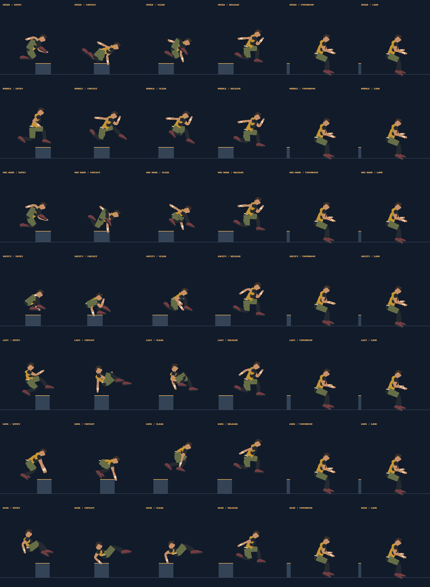

# Connected vault motion

This pass covers speed, hurdle, one-hand, safety, lazy, Kong and Dash vaults, plus the double-Kong link and the rotating reverse-vault pose. It follows the same contact-first approach as the climb and mantle studies. [London Parkour's Complete Dash](https://londonparkour.com/tutorials/complete-dash/) informed the feet-first carry and rear palm press; its [tutorial catalogue](https://londonparkour.com/tutorials-category/) distinguishes the separate vault families.

## Changes and comparison

- Contact now flows into a separate clearance pose instead of holding the same silhouette through the middle of a vault. Safety uses opposite hand/foot support; Dash has an authored hand approach and a lower press that reaches both narrow and wide obstacles.
- The last vault pose matches the landing preparation. Double Kong links through a shared coil instead of inserting a running pose between pushes.
- Action changes capture a bounded outgoing pose, including unfinished transitions, and blend into the new action. The data is stored with replay frames, so live playback, ghosts and lab scrubbing use the same pose rather than renderer history.
- Frame interpolation blends across action/contact changes and interpolates anticipation. The running recovery no longer changes reach with a discontinuous sign function. Knee planes stay consistent, recovering wrists arc below the shoulder, and reverse-vault joint correction follows the body's rotation. Alternating stride contacts also use continuous curves instead of switching legs in one frame.
- Clean vaults have minimum durations of 0.36 seconds (speed/hurdle/one-hand), 0.44 seconds (Dash/lazy/safety) and 0.52 seconds (Kong). Mistimed safety recoveries retain a slower 0.85-second minimum. Longer authored traversals keep their existing duration. Replay version advances to v31 because traversal timing changed; previous-version personal bests remain stored under their old key.

[Before: six samples per vault](vaults-before.png)



## Verification

Tests cover pose continuity at simulation boundaries and six-tick replay intervals, dense samples through each vault and signature technique, stable running recovery, serialized transition snapshots and history-independent rendering. Existing hand support, mantle/climb foot support, limb length, full-course timing and deterministic replay checks remain in place.

The images are offline renders of the actual runner mesh, not browser playback. Reproduce the current study with:

```sh
node scripts/runner-study.cjs --vaults
python3 scripts/render-runner-study.py /tmp/skystride-runner-study.json docs/vaults-after.png
```

The Python renderer requires Pillow. The baseline used the pre-change model and motion files from Git with the same sampling/export script.
